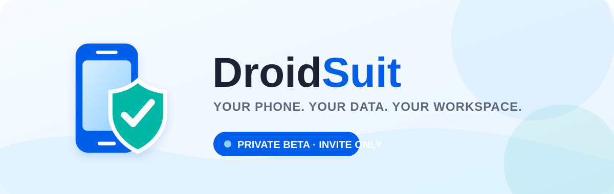
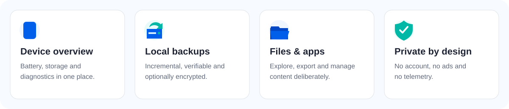
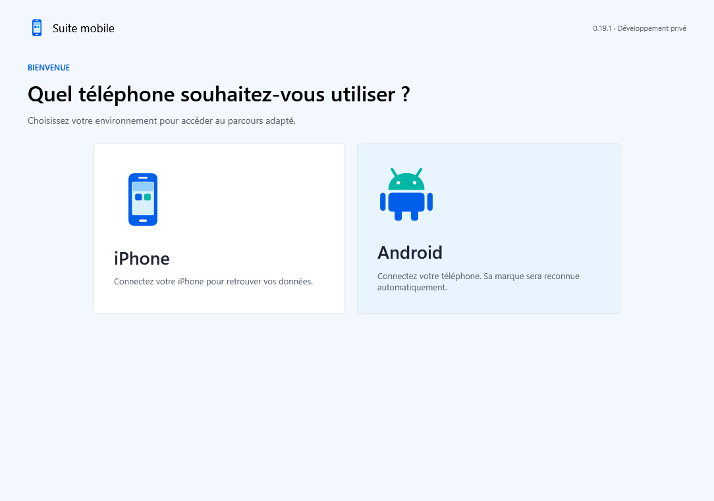
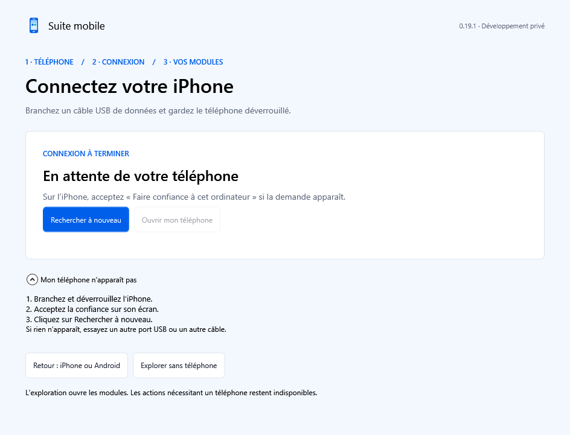
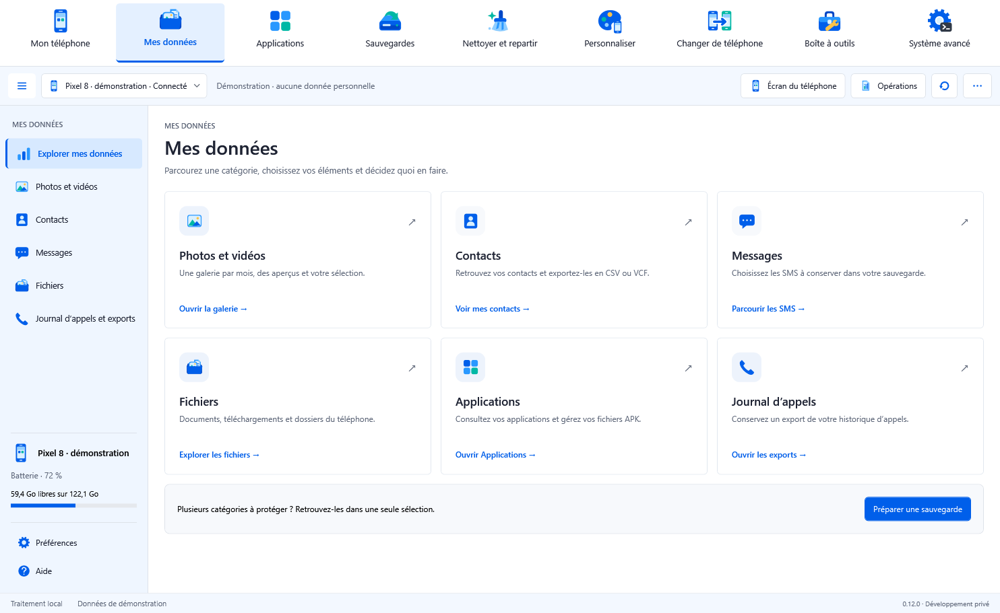
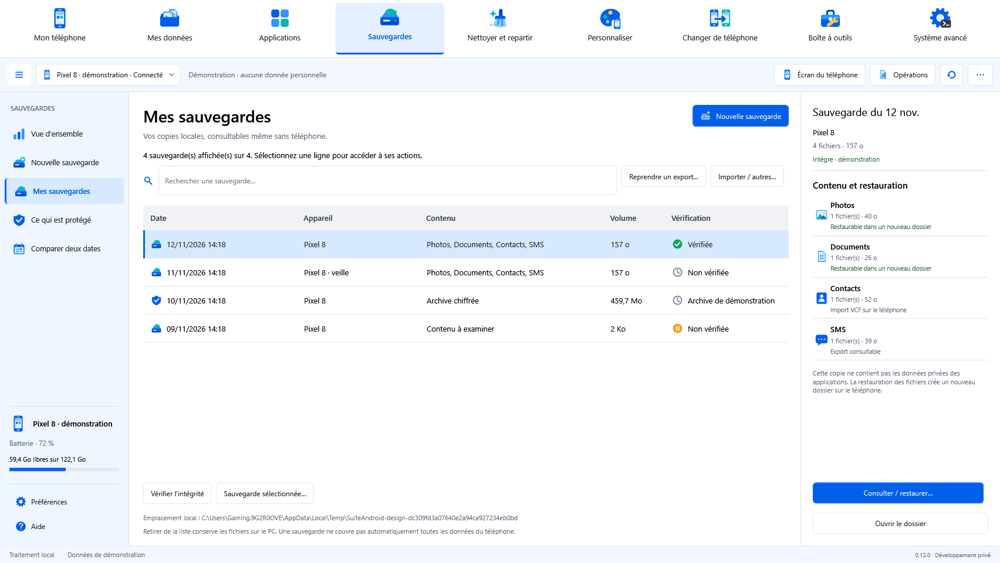

  

    

  <strong>Manage, back up and explore Android and iPhone devices from Windows.</strong> 
  Local-first. No account. No telemetry. Private beta by invitation.

    

  
  
  

 

## ✨ One workspace, two mobile ecosystems

DroidSuit is a private Windows application built to make phone management clearer and more deliberate. It brings device information, files, media, applications, backups and diagnostics into one coherent workspace while keeping user data on the computer.

The project is under active development. Android currently has the broadest feature set; the iPhone workspace is being expanded progressively from device inspection, media and local backup tools.

 

  

## 📱 Android workspace

- USB and Wi-Fi connection through ADB, with explicit device selection
- Device, battery, storage and diagnostic information
- File, photo, video, contact, message and call-log export tools
- Application inventory, compatible APK export and guided reinstallation
- Local, incremental and verifiable backups with optional encrypted archives
- Large-file and duplicate review before any cleanup action
- Screen mirroring and control through a dedicated scrcpy window
- Guided access to advanced manufacturer, bootloader and root diagnostics

## 🍎 iPhone workspace

- Trusted-device connection and device overview
- Battery, capacity and storage information
- Read-only photo and video browsing with local export
- Shared application documents and installed-app inventory
- Local backup discovery, creation and verification tools
- Diagnostic export for troubleshooting

The iPhone experience is earlier in development. Selective contacts and messages, restoration, migration and device control are not presented as available today.

## 🖼️ Development preview

  
  

  
  

Current private-development interface. Screens use synthetic demonstration data; DroidSuit branding is being rolled out across the application.

## 🔒 Built around local ownership

DroidSuit does not require a user account and does not include advertising or telemetry. Exports and backups remain on the Windows computer. Sensitive operations are designed to be explicit, reviewable and reversible when the connected platform allows it.

## 🧪 Private beta

DroidSuit is not a public download yet. Access is provided progressively by invitation while real-device coverage, recovery paths and packaging are validated.

Watch this repository to follow the project and future invitation waves.

## ⚠️ Current scope

DroidSuit is development software, not a promise of universal phone compatibility or complete device recovery. A successful local backup is not necessarily a full system image. Restoration, manufacturer tools and advanced Android operations depend on the device, system version and vendor restrictions.

## 🧭 Status

**Active development · private source · Windows desktop · France**

The source code and distributable builds are intentionally not published in this repository. This space documents the product, its interface and its progress.

 

  <a href="https://kloups.fr">Kloups Studio</a>
  &nbsp;·&nbsp;
  <a href="https://github.com/walou444">GitHub</a>

